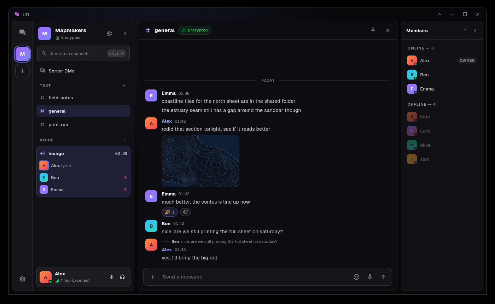
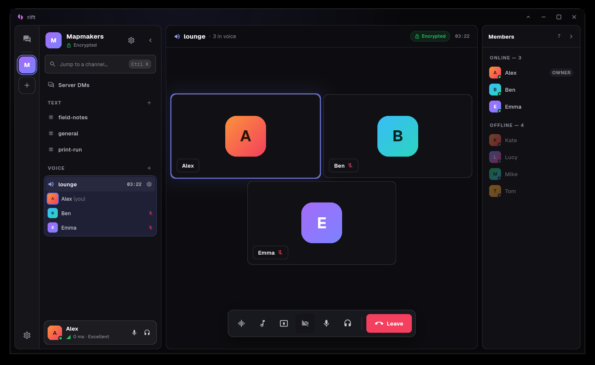
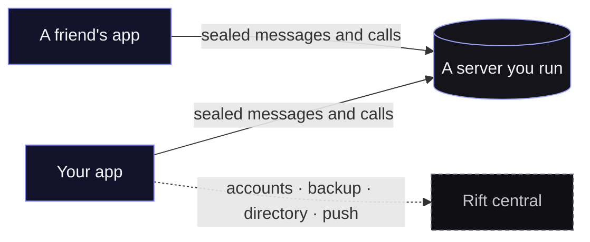

<p align="center">
  
</p>

<h1 align="center">Rift</h1>

<p align="center">
  <b>Your own place to talk. Nobody else's.</b><br>
  Chat, voice, video and screen sharing — end-to-end encrypted, on servers you run.
</p>

<p align="center">
  <a href="https://github.com/awais-amjed/rift/releases/latest"></a>
  
  
</p>

<p align="center">
  <a href="https://github.com/awais-amjed/rift/releases/latest"><b>Download</b></a>
  &nbsp;·&nbsp;
  <a href="https://joinrift.app">Website</a>
  &nbsp;·&nbsp;
  <a href="https://docs.joinrift.app">Run a server</a>
  &nbsp;·&nbsp;
  <a href="ARCHITECTURE.md">How it works</a>
  &nbsp;·&nbsp;
  <a href="https://github.com/awais-amjed/rift-bot-sdk-node">Build a bot</a>
</p>

<br>

<p align="center">
  
</p>

<br>

<table>
  <tr>
    <td width="33%" valign="top">
      <h3>Encrypted on your device</h3>
      Messages, files, voice notes and calls are sealed and signed before they
      leave. The server stores ciphertext and never holds a key that opens it.
    </td>
    <td width="33%" valign="top">
      <h3>On a server you run</h3>
      A spare PC or a small VPS. From a group of friends to a community of
      thousands — the same server scales with the machine you give it.
    </td>
    <td width="33%" valign="top">
      <h3>Open, all the way down</h3>
      The app, the server, the shared service and the bot SDKs. Read it, run
      it, change it — and check the encryption for yourself.
    </td>
  </tr>
</table>

## Get started

### 1. Install Rift

| Platform | Download |
|:--|:--|
| **Windows** · 64-bit | [`Rift-<version>-windows-x64-setup.exe`](https://github.com/awais-amjed/rift/releases/latest) |
| **Linux** · x86-64 | [`rift-<version>-linux-x64.AppImage`](https://github.com/awais-amjed/rift/releases/latest) |
| **Android** · 7 or newer | [`rift-<version>-android.apk`](https://github.com/awais-amjed/rift/releases/latest) (Google Play coming soon) |
| **Browser** | [web.joinrift.app](https://web.joinrift.app) |
| **macOS** and **iOS** | On the way |

**Windows** — run the installer. It isn't signed yet, so Windows may say
*"Windows protected your PC"*: choose **More info**, then **Run anyway**.

**Linux** — make the AppImage executable and run it:

```bash
chmod +x rift-*-linux-x64.AppImage
./rift-*-linux-x64.AppImage
```

From its first start Rift is in your app menu, with its icon. It needs Ubuntu
24.04, Debian 13, Fedora 40, Mint 22 or newer, or any rolling distribution.

Both keep themselves up to date: Rift downloads a new version in the
background, says so in the title bar, and a restart puts it in place.

**Android** — open the APK once it has downloaded and allow installs from
your browser when Android asks. It works on every phone; the release also has
one APK per architecture (`arm64-v8a`, `armeabi-v7a`, `x86_64`) for whoever
knows theirs. It does not update itself: install the next release's APK over
it.

<details>
<summary><b>Rather have a folder?</b> Use the <code>.tar.gz</code></summary>
<br>

The release also has a `.tar.gz`. Unpack it and run `riftchat` inside; it offers
to add itself to your app menu, but does not update itself:

```bash
tar -xzf rift-*-linux-x64.tar.gz
./rift-*-linux-x64/riftchat
```

</details>

<details>
<summary><b>Starting with your computer</b></summary>
<br>

Rift opens when you sign in to your computer. **Settings → General → Startup**
turns that off, or has it start minimized, waiting in the tray.

</details>

### 2. Sign in

Open Rift and sign in with your Rift account. Your identity is backed up,
encrypted, and friends can find you by name.

<sub>Prefer not to give an email? **Privacy mode** keeps your identity on this device only — at the cost of the backup.</sub>

### 3. Join a server

- **Got an invite link?** Press **+** in the server list, then **Join server**,
  and paste it.
- **Looking for a community?** Press **+**, then **Browse servers**, to see
  the public ones.

### 4. Or run your own

Docker, about 4 GB of RAM and a domain pointing at the machine. Two commands,
then a setup page that generates every secret and hands you the first invite
link:

```bash
curl -fsSL -o docker-compose.yml https://joinrift.app/self-host/docker-compose.yml
docker compose up -d
```

The [installation guide](https://docs.joinrift.app/install/) walks through
every step, and [sizing the machine](https://docs.joinrift.app/sizing/) has
measured numbers for servers from fifty members to fifty thousand. There's a
local-testing mode for trying Rift on your own network first.

## What it does

<table>
  <tr>
    <td width="50%" valign="top">
      <b>Voice, video and screen sharing</b><br>
      Native capture, your own resolution, frame rate and bitrate, and system
      audio on Linux and Windows.
    </td>
    <td width="50%" valign="top">
      <b>Channels and DMs</b><br>
      Text and voice channels, private channels and roles, DMs on a server,
      and DMs with friends across servers.
    </td>
  </tr>
  <tr>
    <td valign="top">
      <b>Private calls in DMs</b><br>
      Encrypted with a key only the two of you can work out — not even the
      server's owner can listen in.
    </td>
    <td valign="top">
      <b>The everyday tools</b><br>
      Replies, forwards, reactions, mentions, pins, polls, voice messages and a
      soundboard. Link previews are made by the sender.
    </td>
  </tr>
  <tr>
    <td valign="top">
      <b>Your server, your rules</b><br>
      Set how long history is kept, how big an attachment can be, how many fit
      in a call, and how much storage it all gets.
    </td>
    <td valign="top">
      <b>Moderation that fits</b><br>
      Reports, time-outs, kicks and bans for admins; for everyone, a say in who
      can message them and a block that works.
    </td>
  </tr>
  <tr>
    <td valign="top">
      <b>Sensitive images, blurred for you</b><br>
      A classifier that runs on your device, since a server can't scan what it
      can't read.
    </td>
    <td valign="top">
      <b>Bots and webhooks</b><br>
      Through the <a href="https://github.com/awais-amjed/rift-bot-sdk-node">TypeScript</a>
      and <a href="https://github.com/awais-amjed/rift-bot-sdk-rust">Rust</a> SDKs.
      What a bot writes is marked, because the server can read it.
    </td>
  </tr>
</table>

<p align="center">
  
</p>

## Rift and Discord

Most of what you use every day — plus what only running it yourself can give.

<table>
  <tr>
    <th align="left" width="50%">In both</th>
    <th align="left" width="50%">Only on Rift</th>
  </tr>
  <tr>
    <td valign="top">
      ✓ Text and voice channels<br>
      ✓ Direct messages and DM calls<br>
      ✓ Video calls and screen sharing<br>
      ✓ Screen sharing with system audio<br>
      ✓ 1080p 60fps screen sharing <sub>— Nitro on Discord</sub><br>
      ✓ Large file uploads <sub>— Nitro on Discord</sub><br>
      ✓ Soundboard and voice messages<br>
      ✓ Replies, reactions, pins and polls<br>
      ✓ Bots and webhooks<br>
      ✓ A directory to find communities<br>
      ✓ End-to-end encrypted calls
    </td>
    <td valign="top">
      <b>✓ End-to-end encrypted messages</b><br>
      <b>✓ Run your own server</b><br>
      <b>✓ Fully open source</b>
    </td>
  </tr>
</table>

## How it fits together



| Piece | Where | What it does |
|:--|:--|:--|
| **The app** | this repository | Holds your identity: one seed on your device, backed up only if you choose, and encrypted before it leaves. |
| **A server** | [`rift-self-host`](https://github.com/awais-amjed/rift-self-host) | Yours, or a friend's. Stores ciphertext it cannot open and enforces who may do what. |
| **Central** | [`rift-central`](https://github.com/awais-amjed/rift-central) | The one shared piece: accounts and encrypted backups, the server and bot directories, and the relay that wakes phones. It never sees a server's messages. |

## Building it

You need [Flutter](https://docs.flutter.dev/get-started/install) (stable,
3.41 or newer) and a [Rust](https://rustup.rs) toolchain.

```bash
flutter pub get
flutter run -d linux        # or windows, android, chrome
```

The Rust crate builds itself through `flutter_rust_bridge` and Cargokit on the
first run; `build_rust_local.sh` builds it by hand.
`scripts/package_linux.sh` builds the release archive the way the release
workflow does.

<details>
<summary><b>Linux build dependencies</b></summary>
<br>

You need clang 21 or newer, because the WebRTC library refuses an older one,
and these development packages:

```bash
# Debian and Ubuntu. 24.04 ships clang 18: take clang-21 from apt.llvm.org,
# and build with CC=clang-21 CXX=clang++-21.
sudo apt install cmake ninja-build pkg-config libgtk-3-dev libsecret-1-dev \
  libgstreamer1.0-dev libgstreamer-plugins-base1.0-dev libpulse-dev libva-dev \
  libayatana-appindicator3-dev

# Arch
sudo pacman -S clang cmake ninja gtk3 libsecret gstreamer gst-plugins-base \
  libpulse libva libayatana-appindicator
```

</details>

### Tests

```bash
flutter analyze
flutter test                 # pure logic, crypto and layout invariants
./scripts/style_check.sh     # size budgets, lazy lists, literals, layering
```

The databases have their own suites in the server repositories. Anything that
needs a live server — realtime delivery, key distribution, calls, layout at a
width — is driven by hand; [`TESTING.md`](TESTING.md) records what has been
checked and how to drive each client.

## Documentation

| Document | For |
|:--|:--|
| [`ARCHITECTURE.md`](ARCHITECTURE.md) | the shape of the system, and the decisions behind it |
| [`WIRE.md`](WIRE.md) | the exact formats a second implementation must match |
| [`BOTS.md`](BOTS.md) | what a bot may see, hear and say |
| [`TESTING.md`](TESTING.md) | what has been verified live, what has not, and how to drive the app |
| [`AGENTS.md`](AGENTS.md) | the conventions this codebase follows |
| [`CODE_STYLE.md`](CODE_STYLE.md) | size budgets, one widget per file, where constants live |

What a client may call on a server, and over which transport, is `API.md` in
`rift-self-host`. Running a server is covered by the
[self-hosting guide](https://docs.joinrift.app/).

## Related repositories

Clone them side by side: `tool/gen_wire_vectors.dart` writes each bot SDK's
copy of the wire contract, and the docs refer to the others by name.

| Repository | What it is | Who runs it | Licence |
|:--|:--|:--|:--|
| **`rift`** | this: the app | — | GPL-3.0 |
| [`rift-self-host`](https://github.com/awais-amjed/rift-self-host) | a server's schema, endpoints and console | anyone | AGPL-3.0 |
| [`rift-central`](https://github.com/awais-amjed/rift-central) | accounts, the server and bot directories, the push relay | the project | AGPL-3.0 |
| [`rift-bot-sdk-node`](https://github.com/awais-amjed/rift-bot-sdk-node) | the TypeScript bot SDK | bot authors | Apache-2.0 |
| [`rift-bot-sdk-rust`](https://github.com/awais-amjed/rift-bot-sdk-rust) | the Rust bot SDK | bot authors | Apache-2.0 |

## Licence

[GPL-3.0](LICENSE). Third-party notices ship with the app in
[`assets/licenses/`](assets/licenses/).

<br>

<p align="center">
  <sub><a href="https://joinrift.app">joinrift.app</a> · <a href="https://docs.joinrift.app">docs</a> · <a href="https://github.com/awais-amjed/rift/issues">report a bug</a></sub>
</p>
